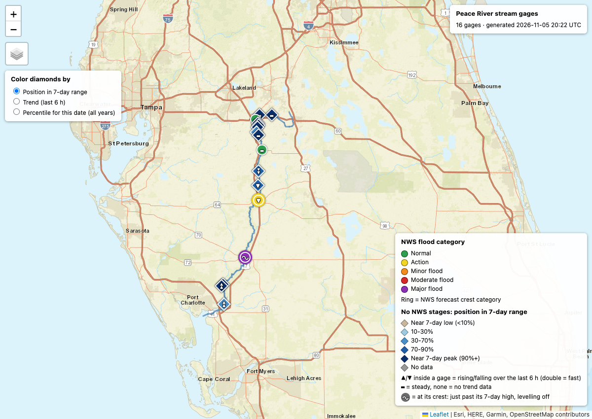
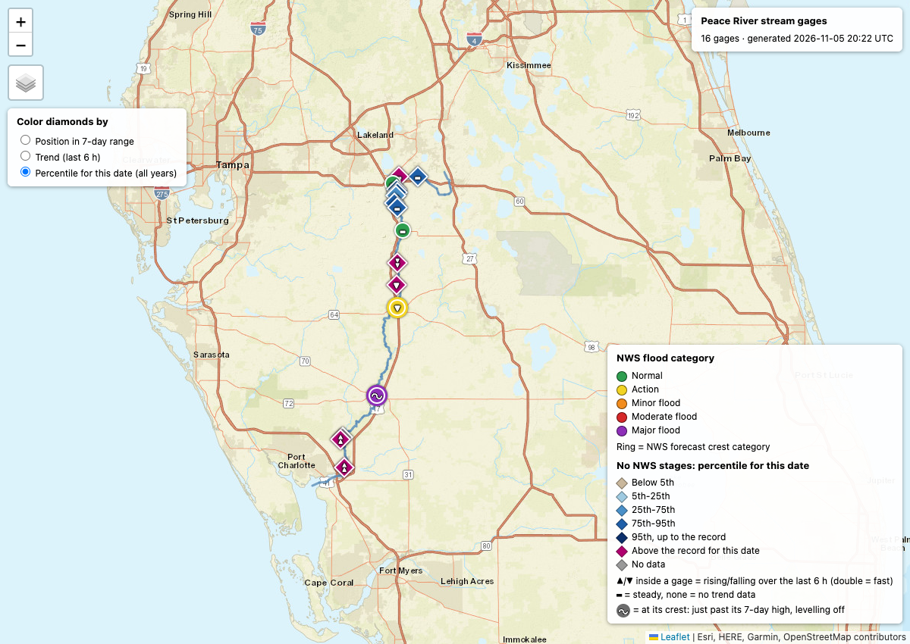

# Stream gage map

[](https://github.com/robsv/streamgage/actions/workflows/ci.yml)
[](LICENSE)


[](https://docs.astral.sh/ruff/)
[](https://www.conventionalcommits.org)

Turns a river name into a single self-contained HTML map: the river as a line, every USGS stream gage
on it as a colored marker, and a popup for each gage with its current stage, how it has moved over the
last week, flood thresholds, and the National Weather Service (NWS) forecast crest where one exists.
No API keys or accounts are needed; all data comes from free public U.S. government services.

> **Important: not for safety decisions.** This is a personal data-visualization tool. The readings
> are USGS provisional data and the forecasts are NWS products, drawn as a snapshot of the moment the
> script ran. The colors, trend glyphs and percentiles are this tool's own summaries and can be wrong
> or out of date, and the code can contain bugs. Do not use this map to decide whether to evacuate,
> drive through water, or protect property. For flood warnings use the official NWS pages at
> [water.noaa.gov](https://water.noaa.gov), and in an emergency call your local emergency number
> (911 in the US).
>
> Provided as is, without warranty; see `LICENSE`. USGS, NOAA, NWS, Esri and Leaflet are names of
> their respective owners. This project is independent and not affiliated with or endorsed by any of
> them.

## Dedication

This project was inspired by the unnamed storm that flooded parts of Florida in early November 2026.
According to reports as of November 5th, 2026, it dropped up to two feet of rain, and the Space Coast,
including Palm Bay, was hit hardest. On the morning of November 2nd, I was traveling north on US 17 and
saw some of the flooding between Arcadia and Zolfo Springs.

The sample maps below were made on November 5th, 2026, as the Peace River at Arcadia reached major
flood, far above anything in the USGS record there for that date (95 years of record).

Lives were lost; this project is dedicated to their memories, and to everyone who lost their home.

## Sample

Peace River, FL, in the default "position in 7-day range" coloring. Circles are gages with NWS flood
stages: Zolfo Springs is yellow (action stage) and falling, with a yellow ring because its forecast
crest only reaches action stage, and Arcadia is purple (major flood) with a purple ring because its
forecast crest is major flood. Diamonds are gages without NWS stages. The glyph inside each marker is
the 6-hour trend; the wave on Arcadia means it is cresting.



The same map in the "Percentile for this date (all years)" coloring. The yearly percentile reads 99 or
100 for every one of these gages, but against every past year's values for this date, the magenta
diamonds are higher than anything on record for the date, and the others fall in the blue bands:



Clicking a gage opens its popup: the stage, the 6-hour trend, the 24-hour change, the 7-day range
and peak, how the stage compares with the same date in every past year, and a 7-day sparkline. Here
is Peace River at Arcadia, in major flood, which is higher than any value in 95 years of records for
this date (the previous high was 8.57 ft in 2006). Its trend row says "Cresting": the stage peaked 45
minutes earlier and has levelled off:


All three images are snapshots from 2026-11-05 (3:22 pm EST), made with
`python3 streamgage.py "Peace River" --state FL` and a headless-Chrome screenshot.

The same river at four moments of the storm, from the first rise to the crest, is on its own page:
[Arcadia, November 2026: a storm in four frames](docs/arcadia-nov-2026.md).

## 1. Set up

This project uses [pixi](https://pixi.sh) to manage its environment (Python 3.10 or newer and the
`requests` package).

```
git clone https://github.com/robsv/streamgage.git
cd streamgage
pixi install
```

Without pixi, any Python 3.10+ with `pip install requests` works too.

## 2. Run it

```
pixi run map "Peace River"
open peace_river_gages.html        # macOS; on other systems, open the file in a browser
# or, without pixi:
python3 streamgage.py "Peace River"
```

`pixi run map` is a shortcut for `python streamgage.py`, so every option below works after it. The
first run creates the environment. The script prints a summary table to the terminal and writes
`peace_river_gages.html` in the current directory. The page loads Leaflet and the map tiles from the
web, so you need an internet connection to view it.

```
pixi run map [river] [--state STATE] [--anchor SITE] [--list] [--distance MILES] [--retired] [--as-of TIME] [--out PATH]
```

Options (`--help` lists them all):

| Option | What it does |
|---|---|
| `river` | River name as USGS spells it, such as `"Myakka River"`. Also used as the map title. |
| `--state` | State abbreviation or full name (`FL`, `Florida`). Needed when the name exists in more than one state. |
| `--anchor` | A USGS site number on the river (such as `02296750`). Skips the name lookup. |
| `--list` | Print the candidate gages for the name, with basin sizes, and exit without drawing. |
| `--distance` | Miles to walk upstream and downstream of the anchor. Default: `200`. |
| `--retired` | Also draw gages that no longer report stage (retired, or offline) as faint markers in a layer you can switch off. See [Sites that are not on the map](#sites-that-are-not-on-the-map). |
| `--as-of` | Show the river as it was at a past moment: an ISO 8601 time with its UTC offset, such as `2026-11-03T12:00-05:00` or `2026-11-03T17:00Z`. See [The river at a past moment](#the-river-at-a-past-moment). |
| `--out` | Output HTML path. Default: the river name with underscores plus `_gages.html` (`usgs_<site>_gages.html` when only `--anchor` is given). With `--as-of`, the moment is added to the name (`peace_river_2026-11-03_1200_gages.html`), so a past map never overwrites the current one. |

At least one of `river` or `--anchor` is required.

```
# Look up the river by name
python3 streamgage.py "Peace River"
python3 streamgage.py "Myakka River"

# Names shared by several states need --state
python3 streamgage.py "Little River" --state NC

# See which gages match a name before drawing anything
python3 streamgage.py "Peace River" --list

# Skip the lookup and start from a specific gage
python3 streamgage.py "Peace River" --anchor 02296750

# Write to a specific file
python3 streamgage.py "Myakka River" --out ~/Desktop/myakka.html

# The river as it was at noon Eastern Standard Time on November 3rd
python3 streamgage.py "Peace River" --as-of 2026-11-03T12:00-05:00
```

**Finding a gage number yourself.** On waterdata.usgs.gov, open any gage on the river. The 8-digit
number at the end of the page URL is the site number. For example, `USGS-02296750` in
`https://waterdata.usgs.gov/monitoring-location/USGS-02296750/` is the Peace River at Arcadia, FL.

**What the name lookup does.**

1. It searches USGS stream gages whose name starts with the river name, such as `PEACE RIVER AT ...`.
2. If the matches are in more than one state, it stops and asks for `--state`.
3. It uses the matching gage with the largest drainage area as the anchor. That gage is at the
   downstream end of the river, so walking upstream from it covers the whole river.
4. It prints the gage it chose so you can see what it did.

If nothing matches, try the official spelling, or use `--list` or `--anchor`.

**Terminal output.** While it works, the script prints a summary of where every site on the river went
(to stderr). With `--as-of` it first says which moment it is showing:

```
45 sites on river: 16 reporting stage; 29 not (7 retired, 13 field visits only, 5 water quality only, 4 no data); --retired draws the 7 that no longer report
```

After writing the file, it prints one line per gage, from north to south:

```
02294775    37.08 ft  p74       +0.007 ft/h  Peace River At Clear Springs Near Bartow FL
02295637    15.78 ft  action   -> crest 15.7 ft action 2026-11-05T18:00:00Z -0.041 ft/h  Peace River At US 17 At Zolfo Springs, FL
02296750    16.15 ft  major    -> crest 16.4 ft major 2026-11-06T00:00:00Z +0.022 ft/h  Peace River At SR 70 At Arcadia, FL
02297345     3.58 ft  p100*     +0.035 ft/h  Peace River At Platt FL
02297350     2.99 ft  REC       +0.096 ft/h  Peace River NR Peace River Heights NR Ft. Ogden FL
```

The columns are the USGS site number, the current stage, then either the NWS flood category (with the
forecast crest, if any) or, for gages with no NWS stages, the percentile for this calendar date over
all years of record (`p74` is the 74th percentile, `REC` is higher than every past value for the date,
`LOW` is lower than every one), the 6-hour trend in feet per hour (`n/a` when there are too few
readings or the newest one is more than 3 hours old), and the gage name. A `*` after the percentile
(`p100*` above) means USGS has no long-term statistics for the gage, so the number is the percentile
within the past year instead.
With `--retired`, a second list follows, headed "No longer reporting stage", with each gage's site
number, the date of its last data, whether it is `retired` or `offline`, and its name.

## What you get

- **A marker for every gage** that reported stage in the last 3 days, on the river's own mainstem.
  Circles are colored by NWS flood category. Diamonds, for gages with no NWS flood stages, are colored
  by a mode you pick on the page.
- **A trend glyph on every marker**: rising, falling, or steady over the last 6 hours, or a wave when the
  stage has just crested.
- **A popup per gage** with the stage, trend, 7-day range and peak, how the stage compares with the same
  date in every past year, a 7-day sparkline, and the NWS forecast chart where there is one.
- **One file.** The page embeds its data, so you can email it or keep it. It is a snapshot; run the
  script again for fresh data.

### Marker shape: which method colors the gage

| Shape | Meaning |
|---|---|
| Circle | The gage has NWS flood stages. It is colored by NWS flood category. |
| Diamond | The gage has no NWS flood stages. It is colored by the mode picked in the "Color diamonds by" control (default: position in its 7-day range). |
| Small hollow gray ring | With `--retired` only: a gage that no longer reports stage. It has no color mode and no trend. |

This split exists because a raw stage number means little across gages. Datums differ, so one gage
may read 13 ft in flood while another reads 97 ft because its zero point is an elevation above sea
level. NWS publishes flood thresholds for only some gages. Where it does, the map uses them. Where it
doesn't, the map says how high the river is relative to that gage's own recent history.

### Circle colors: NWS flood category

| Color | Category | Meaning |
|---|---|---|
| Green | Normal | Below the action stage |
| Yellow | Action | At or above the action stage |
| Orange | Minor flood | At or above the minor flood stage |
| Red | Moderate flood | At or above the moderate flood stage |
| Purple | Major flood | At or above the major flood stage |

### Diamond colors: three modes

The "Color diamonds by" control at the top left switches between three views. Circles never change.

**Position in 7-day range (default).** Where the current stage sits between the lowest and highest
reading of the last 7 days. 100% means the gage is at its peak right now, and a drop from 100%
means it has crested. Unlike the yearly percentile, it doesn't saturate during a flood. Gray when the
range is under 0.1 ft or there are too few readings.

| Color | Position |
|---|---|
| Tan | Below 10% (near the 7-day low) |
| Light blue | 10% to 30% |
| Medium blue | 30% to 70% |
| Darker blue | 70% to 90% |
| Navy | 90% and up (near the 7-day peak) |

**Trend (last 6 h).** The slope of a least-squares fit through the last 6 hours of readings.

| Color | Rate |
|---|---|
| Dark blue | Falling faster than 0.10 ft/h |
| Light blue | Falling, between 0.02 and 0.10 ft/h |
| Gray | Steady, within 0.02 ft/h |
| Light red | Rising, between 0.02 and 0.10 ft/h |
| Dark red | Rising faster than 0.10 ft/h |

**Percentile for this date (all years).** Where the current stage falls among the values for this same
calendar day in every year on record. On November 5, the 90th percentile means the stage is higher than
on about 90% of past November 5ths. It uses the USGS daily statistics, which cover as many as 90 or
more years for some gages, and the popup says how many years and gives the median and record for the
date. A stage higher than every past value for the date gets its own color, so a flood doesn't just
pile up at "100".

| Color | Percentile for this date |
|---|---|
| Tan | Below 5th (unusually low) |
| Light blue | 5th to 25th |
| Medium blue | 25th to 75th (typical) |
| Darker blue | 75th to 95th |
| Navy | 95th, up to the record |
| Magenta | Above the record: higher than every past value for this date |
| Gray | No long-term statistics: USGS publishes none for the gage, or it has under 10 years of record |

A record built from 10 years means much less than one built from 90, so the popup always gives the
years. The percentile from the past year alone is still in each diamond's popup ("Past year"), where it
is useful as a second opinion, but it is no longer a color mode: during a flood it read 99 or 100 for
nearly every gage and couldn't tell them apart.

### The trend glyph

Every gage with a trend gets a glyph inside its marker, whichever color mode is selected: ▲ rising,
▼ falling, doubled when the rate is faster than 0.10 ft/h, and ▬ steady. No glyph means no trend could
be computed: too few readings, or the newest reading is more than 3 hours old.

A wave (a crest followed by a trough) replaces the ▬ on a gage that is **cresting**: its stage has levelled
off just past its 7-day high. To count, a gage must be steady (within 0.02 ft/h over the last 6 hours),
in the top 5% of its 7-day range, and its 7-day peak must already be behind it: at least 15 minutes ago
and no more than 6 hours ago.

The rule is strict on purpose. A gage still setting new highs is not cresting, even if it is rising by
only a few thousandths of a foot an hour; for those, the popup's trend row says "Steady, at its 7-day
high". Calling a crest late is the safer mistake. The wave changes only the glyph: the marker's color is
the same as before, and in the Trend color mode a cresting gage is still the "steady" gray. The legend
explains the wave whenever at least one gage on the map has it.

### The forecast ring

A circle with an NWS forecast has a colored ring around it. The ring is the category of the forecast
crest, the highest stage in the rest of the forecast. A red circle with a purple ring means the gage
is in moderate flood now and the forecast crest reaches major flood. A circle with no ring has no
usable forecast.

### Popups

Click any marker to see:

- the gage name and USGS site number
- the current stage and the time it was reported
- for NWS gages: the flood category, the action, minor, moderate and major stages, and a link to the
  NWS gauge page
- for NWS gages with a forecast: the crest stage, its category and time, plus a small chart of the
  forecast with the flood stages as dashed lines
- for every gage: the 6-hour trend and rate ("Cresting" with the wave when the rule above is met, or
  "Steady, at its 7-day high" for a steady gage whose latest reading is the week's high), the 24-hour
  change, the 7-day range with the current position in it, the 7-day peak and how long ago it
  happened, and a 7-day sparkline
- for every gage: how the stage compares with this date in past years: its percentile, the years
  of record, the median and the record for the date, or "above the record" with the previous high
  (a gage with no long-term statistics says so)
- for diamonds: the percentile of the past year
- a link to the gage's USGS page

A retired gage's popup shows its status (retired, or offline), the date of its last data and how long
ago that was, the years its record covers, what it measured (stage, discharge, water temperature and
so on), and the link to its USGS page.

### Sites that are not on the map

"45 sites on river, 16 reporting stage" can look as if 29 gages are broken. They are not: the count
is every USGS location in the river's network, and most of those are not live gages. For each site that
is not reporting stage, the script reads its USGS site catalog (what the site has ever measured, and
when) and sorts it:

| Category | What it is |
|---|---|
| retired | A stage or discharge record (real-time or daily) whose last data is more than a year old |
| offline | The same, but the last data is within the past year |
| discharge only | Reporting streamflow now but not stage (not drawn: stage is what the map shows) |
| field visits only | No sensor; staff visited with a flow meter and the measurements were stored |
| water quality only | Water samples only, with no stage or flow record |
| other data only | Something else, such as annual peak flows |
| no data | In the USGS database, with no data stored |

On the Peace River, for example, 7 of the 29 are retired gages, 13 are field-visit sites (many of them
a cluster near Bartow, measured in short studies), 5 are water-quality sites and 4 have no data. Only
retired and offline gages can be drawn, with `--retired`: the others never had a stage record to show.
The catalog is read for the summary line either way. If that request fails, the summary says "site
details unavailable" and the map is unaffected.

### The river at a past moment

`--as-of TIME` draws the map as it would have looked at a past moment, so you can look back at the peak
of a flood without having been there to run the tool. Everything is worked out as of that moment: the
latest readings, the 6-hour trend, the 7-day range and peak, whether a gage was cresting, and the
percentile for the reading's own calendar day. The page's title panel says "as of" with the moment, and
when it was generated. The output file name carries the moment, so it never overwrites the current map.

The time must carry its UTC offset (`2026-11-03T12:00-05:00` is noon Eastern Standard Time;
`2026-11-03T17:00Z` is the same instant in UTC). A bare clock time would be a guess about the time zone,
and the tool has no time zone database, so it refuses one with a message that shows the fix. It also
refuses a time that has not happened yet.

What a past map cannot have:

- **Forecasts.** The NWS keeps no archive of past forecasts: the service returns only the current one,
  and ignores a date you give it. A past map has no forecast rings, crests or charts, and a gage's
  popup says "not kept for past times".
- **The data exactly as it looked then.** The readings are USGS provisional data, and the USGS may have
  revised them since. The flood stages and the site catalog are today's.
- **Gages that no longer exist, or that did not exist yet.** A gage that reported then but is retired
  now appears; one installed since does not.

The USGS keeps instantaneous readings for months (a request for five months back worked), so recent
storms are easy to revisit. For a moment far enough back that no gage has readings, the tool says that
no gage was reporting stage. To find a moment worth showing, look at a gage's readings on its USGS page,
or run the tool at a few times and compare. For an example, see
[Arcadia, November 2026: a storm in four frames](docs/arcadia-nov-2026.md), which uses four moments of one flood.

### Basemaps

A layer switcher in the top-left offers Esri Street Map (default), USGS Topo and Esri Satellite.

## How it works

```
river name
   |  USGS monitoring-locations API: gages whose name starts with the name
   v
anchor gage
   |  USGS NLDI: walk the river upstream and downstream
   v
river line + gages on the same mainstem
   |  USGS NWIS instantaneous values: latest gage height (00065), in batches of 100
   v
gages reporting stage in the last 3 days
   |  USGS NWIS instantaneous values: 7 days per gage -> trend, range, peak, sparkline
   |  USGS site catalog: what the sites that are NOT reporting have measured -> summary, --retired
   |  USGS daily statistics: this calendar day over every year of record -> percentile for this date
   |  NOAA NWPS: is there an NWS gauge at the same spot?
   +--> yes: flood stages + stage forecast  -> circle
   +--> no:  past year of daily values      -> diamond (percentile available)
   v
one HTML file (Leaflet map with the data embedded)
```

Details worth knowing:

- **Matching USGS to NWS gages.** For each USGS gage, the script finds the nearest NWS gauge within
  0.5 km, fetches its record, and accepts the match only if the NWS record lists the same USGS site
  number. A nearby gauge for a different site is never used.
- **Only gages on this river's mainstem.** NLDI sites carry a mainstem identifier. Gages on a
  different river (for example, one the downstream walk runs into past the mouth) are dropped. Gages
  NLDI files under the same mainstem are kept, which can include headwater creeks and branches.
- **Only recent data.** Gages with no stage reading in the last 3 days are left off the map.
  Missing-data sentinels such as `-999999` are ignored, both for current readings and for history.
- **Trend and range.** A gage gets recent statistics only if it has at least 12 readings in the last
  7 days that span at least 24 hours; otherwise there is no range, peak, sparkline, 24-hour change or
  trend, and the popup says so. The trend is a least-squares slope over the last 6 hours and needs at
  least 4 readings spanning at least 3 hours. The trend and the 24-hour change are left out when the
  newest reading is more than 3 hours old, so a stale gage is never shown as currently rising or
  falling. The range is the lowest and highest reading in 7 days; a range under 0.1 ft is treated as
  sensor noise and gives no position. The sparkline keeps the last reading of each hour.
- **Percentile for this date.** For each gage the script reads the USGS statistics row for the
  calendar day of its own reading (on the gage's own clock, so a reading at 11:30 pm is still that
  day). The row gives the minimum, the 5th, 10th, 20th, 25th, 50th, 75th, 80th, 90th and 95th
  percentiles and the maximum across all years, and the script interpolates between those points to
  place the current stage; blank columns are skipped, and a flat stretch of repeated values takes the
  middle of its percentile span. The service takes at most 10 sites per request, so a river's gages
  go in batches that run in parallel (two requests, about 640 KB, for 16 gages). A gage with fewer than
  10 years of record, or no row, gets no long-term percentile, and a failed request only costs the
  gages in that batch.
- **Yearly percentile.** It is computed against the daily mean stage. Some USGS gages publish only a
  daily maximum and minimum for stage; for those, the midpoint of each day's maximum and minimum
  stands in for the mean.
- **Forecast crest.** The crest is the highest point in the remaining forecast (from 6 hours ago
  onward), so a peak that has already passed is not reported as the crest. Forecasts are used only
  when the NWS reports them in feet, because the flood thresholds are in feet.
- **Requests run in parallel** (8 workers) for the per-gage lookups. If one of those requests fails,
  that gage loses the affected field (trend, percentile or NWS data) instead of stopping the run.
- **A past moment (`--as-of`).** Every USGS request asks for a window ending at that moment (`startDT`
  and `endDT`) instead of "the latest" or "the last N days", and "recent" and "stale" are judged against
  that moment instead of the clock. The NWS forecast is skipped for a past time, and the year of daily
  values for the yearly percentile ends on that date.
- **Escaping.** Names and titles are escaped before they go into the page, so a gage name or title
  with HTML characters displays as text.

## Data sources

| Service | Used for | URL |
|---|---|---|
| USGS monitoring-locations (OGC API) | Name search for gages and drainage areas | `api.waterdata.usgs.gov/ogcapi/v0` |
| USGS NLDI (Network Linked Data Index) | River flowlines and gages along a river | `api.water.usgs.gov/nldi` |
| USGS NWIS Instantaneous Values | Latest gage height (parameter `00065`) and the last 7 days | `waterservices.usgs.gov/nwis/iv` |
| USGS NWIS Daily Values | Past year of daily gage height (mean, or max/min midpoint) | `waterservices.usgs.gov/nwis/dv` |
| USGS NWIS Statistics Service | Daily statistics over every year of record: percentiles, minimum, maximum | `waterservices.usgs.gov/nwis/stat` |
| USGS NWIS Site Service | What each site that is not reporting has measured, and when | `waterservices.usgs.gov/nwis/site` |
| NOAA NWPS (National Water Prediction Service) | NWS flood stages and stage forecasts | `api.water.noaa.gov/nwps/v1` |
| Leaflet 1.9.4 | Map library, loaded from unpkg | `unpkg.com/leaflet@1.9.4` |
| Esri and USGS tile servers | Basemap tiles | `server.arcgisonline.com`, `basemap.nationalmap.gov` |

**USGS and NOAA gages.** They overlap heavily. USGS operates most river gages in the U.S. and
publishes the measurements. The NWS mostly doesn't run its own river sensors. Its forecast gauges
usually take stage readings from USGS gages, and the NWS adds the flood context: the action and flood
stages, warnings, and forecasts. An NWS gauge such as `ARCF1` (Peace River at Arcadia) carries the USGS
number `02296750`, so it is the same instrument under two names. This tool takes the live readings from
USGS and the thresholds and forecasts from NOAA.

## Privacy

Nothing is uploaded and there is no account. The script sends the river name (and `--state`) to the
USGS monitoring-locations service; USGS site numbers and the walk distance to USGS NLDI and NWIS; and
the bounding box of the gages it found, plus NWS gauge ids, to NOAA. Every host also sees your IP
address and the User-Agent `streamgage-map/1.0`.

The HTML page you open makes requests of its own: your browser loads Leaflet from unpkg (pinned to
version 1.9.4 with a Subresource Integrity hash) and map tiles from the basemap you select (Esri by
default, USGS if you choose USGS Topo). Those hosts see the area you view.

## Code layout and development

```
streamgage.py   the whole tool: data fetching, the HTML page template, and the command line
tests/          pytest suite; tests/fixtures holds trimmed real USGS and NWS responses
pixi.toml       environment and tasks
pytest.ini      test settings
ruff.toml       lint settings
docs/           the sample images used in this README, and a page on Arcadia in November 2026
.github/        CI workflow and Dependabot settings
LICENSE         BSD 3-Clause
```

```
pixi run map "Peace River"      # draw a map
pixi run -e test test           # or: python3 -m pytest -q  (needs pytest; no network)
pixi run -e lint lint           # or: ruff check .  (settings in ruff.toml)
pixi run -e py310 test          # the same tests on Python 3.10, the oldest supported
```

GitHub Actions runs the lint and the tests on Ubuntu and macOS, plus the tests on Python 3.10 (the
oldest supported), for every push to `main` and every pull request that changes more than docs.

- The tool is one file with `requests` as its only dependency. The HTML page is a template string
  inside it, and the page data is embedded as JSON, so each output file is self-contained apart from
  Leaflet and the tiles. The `lint` environment is separate, so ruff is not installed for normal runs.
- **Tests** never touch the network. `tests/fixtures` holds real responses, trimmed to a few days:
  daily values for a site with a daily mean, one with only a daily max and min, and one with all
  three; two days of instantaneous values; an NWS gauge record; the site catalog for five Peace River
  sites (retired, field-visit-only, water-quality-only, and live); and daily statistics for four gages
  (95, 53, 18 and 10 years of record, two with blank percentile columns). Everything else a test needs
  is built in the test. A router fixture (`route` in `tests/conftest.py`) replaces `get_json`, and any
  request a test did not expect fails it. The page's JavaScript logic (marker colors, trend bins, the
  cresting rule, number formatting) runs under Node from `tests/page_logic.js`; those tests skip when
  Node is not installed, and the pixi `test` environment provides it. To record a new fixture, fetch the
  response from the service, trim the long arrays, and save it as JSON.
- Generated maps (`*_gages.html`) are ignored by git.
- Tunable constants are at the top of the file: `STALE_AFTER` (3 days), `MATCH_RADIUS_KM` (0.5),
  `KM_PER_MILE`, `MAX_SITES_PER_REQUEST` (100, the NWIS limit), `RECENT_DAYS` (7), `TREND_HOURS` (6),
  `MIN_RECENT_POINTS` (12), `MIN_RECENT_SPAN_HOURS` (24), `TREND_MAX_AGE_HOURS` (3),
  `MIN_RANGE_FT` (0.1), `MIN_HISTORY_DAYS` (30), `MIN_STAT_YEARS` (10), `MAX_STAT_SITES` (10, the
  statistics service's limit), `RETIRED_AFTER` (a year, the line between offline and retired) and
  `FLOOD_CATEGORIES`. The trend thresholds
  (0.02 and 0.10 ft/h) are in the page's JavaScript, in the `TREND` table.
- To check how a page renders without a browser window, headless Chrome works:
  ```
  "/Applications/Google Chrome.app/Contents/MacOS/Google Chrome" --headless=new \
    --window-size=1200,900 --virtual-time-budget=15000 \
    --screenshot=map.png "file://$PWD/peace_river_gages.html"
  ```
- Missing-data values in USGS and NWS responses are `-999`, `-9999` and `-999999`. The script treats
  anything at or below `-999` as missing.
- Leaflet is loaded with a Subresource Integrity hash. If you change the Leaflet version in the
  template, update both hashes (`openssl dgst -sha256 -binary FILE | openssl base64 -A`).
- Commit messages follow [Conventional Commits](https://www.conventionalcommits.org).

## Troubleshooting

**"No USGS stream gages found with a name starting ..."**
Check the spelling against USGS. Search for the river on waterdata.usgs.gov and look at the gage
names. You can also pass `--anchor` with a site number directly.

**"matches gages in N states"**
Add `--state` with the state you want, such as `--state NC`.

**"No gages on this river are reporting recent gage height"**
No gage on that river reported stage in the last 3 days. Some rivers have only discharge gages, or
all their gages may be down. Try a different anchor, or increase `--distance`.

**"Found gages ... but none are in the NLDI network"**
USGS has gages by that name, but the river-walking service doesn't know them. Use `--anchor` with a
gage on the river that NLDI does know (the Peace River anchor `02296750` is an example).

**The map shows watermarked tiles or blank gray squares**
The basemap provider is blocking or rate-limiting requests. Free tile servers change their rules
from time to time. Two that were tried and dropped:

- OpenStreetMap's own tile servers return 403 for pages opened from `file://`, because no referrer
  is sent.
- CARTO's free tiles began showing "API key required" watermarks.

The current basemaps (Esri and USGS) don't need keys. If one stops working, switch to another in the
layer switcher, or change the tile URLs in the `base` object in `streamgage.py`.

**Popups don't open or the map is empty**
Open the browser's developer console (Cmd-Option-J in Chrome) and look for errors. The most likely
cause is that the Leaflet script from unpkg is blocked or unreachable.

## Known limits

- **Provisional data.** The readings are USGS provisional data and the forecasts are NWS products.
  Use the official NWS warnings at water.noaa.gov for anything that matters.
- **A snapshot, not a live page.** The map shows the data at the time the script ran (the generation
  time is shown in the top-right panel). Run it again for fresh data.
- **A past map has no forecasts and revised data.** See [The river at a past moment](#the-river-at-a-past-moment).
- **Cresting is an observation, and it is late.** It says a gage's peak is behind it, not that the flood
  is over: a second crest can follow. The NWS forecast crest in the popup is the authority on where a
  river is headed. The rule does not use the forecast.
- **Trend thresholds are one-size-fits-all.** 0.02 and 0.10 ft/h are the same for a small creek and a
  large river, so "rising fast" means different things on each.
- **The past-year percentile is only a second opinion.** It uses the past 365 days, so after an
  unusually dry or wet year it can mean less than it sounds, and it saturates at 100 in a flood. It is
  in the popup, not a color mode.
- **Long-term percentiles are interpolated.** USGS publishes only nine percentile points (plus the
  minimum and maximum) for each calendar day, so a value between them is a straight-line estimate, and
  about a quarter of the daily rows for these gages have blank columns (mostly the 5th and 95th, on
  short records).
- **Short records.** Some gages have 10 to 18 years of record. "Above the record" there is a weaker
  statement than at a gage with 90 years, so the popup always gives the number of years. A gage with
  under 10 years gets no long-term percentile at all.
- **Stage may not be comparable across decades.** Datums change and channels move, so a 1932 stage
  and a 2026 stage at the same gage are not always measuring the same thing. Discharge is steadier.
- **A current reading against daily means.** The current stage is one instant, compared with
  distributions of daily mean stage. Near a crest the instant reads a little high; for a flood like
  the sample's, far above the record, that makes no difference, but a small excursion near a
  percentile boundary can tip either way.
- **One day's worth per year.** The statistics are for a single calendar day, so with a short record
  they are noisy; the tool doesn't pool neighboring days.
- **Stage-reporting gages only.** Gages that report only discharge (flow) are not shown. Many USGS
  gages do both. The summary line counts the discharge-only ones, but the map does not draw them.
- **Retired gages are what the USGS catalog says.** Its dates are the ones USGS publishes; other
  agencies may hold data for a site that the catalog lists as ended or empty. Field-visit,
  water-quality and empty sites are never drawn, since they have no stage record to show.
- **Many gages in a small area.** Near some towns, several gages sit within a few hundred meters
  of each other and their markers overlap. Zoom in to separate them.
- **Name lookup limits.**
  - The name must start the USGS site name, such as `Myakka River at ...`. Rivers named another way
    (for example, `Rio Grande`) are less predictable.
  - If two different rivers share a name within one state, the one with the larger basin is chosen.
    Use `--list` to check.
  - The walk follows the main stem of the anchor's river. Tributaries only appear when the anchor
    is on them, although NLDI sometimes files a headwater creek or branch under the same mainstem,
    and those gages are shown.
- **River line past the mouth.** For a tributary with gages downstream on the same mainstem, the
  line can run past its mouth.
- **Browser needed for the map tiles.** Opening the HTML from disk works, but the basemap provider
  must allow requests from `file://` pages (see Troubleshooting).
- **What the tests don't cover.** They use recorded responses, so they can't notice a service
  changing its format; the live services are checked by running the tool. The page is tested as
  logic under Node, not rendered in a browser, so layout (marker overlap, the glyphs inside the
  markers, the legend) is checked by eye.

## Possible future work

- A statewide view: all gages in a state, with marker clustering and a toggle to show only gages in
  or near flood. A state can have hundreds of gages reporting stage, so this needs batching and a
  cache of the NWS thresholds, which rarely change.
- Marker clustering for the crowded areas on a single river.
- Coloring the river line itself between gages.
- Discharge-only gages. Their long-term statistics would also be the better-behaved case, since
  discharge is steadier than stage across decades.
- Trend thresholds scaled to each gage's own typical rate of change.
- Browser-level tests that render the page and check the markers and popups.

## Attribution

Streamflow data: U.S. Geological Survey, National Water Information System (provisional). Flood
stages and forecasts: NOAA National Weather Service. Basemaps: Esri and the USGS National Map.
Map library: Leaflet.

## License

BSD 3-Clause; see `LICENSE`.
