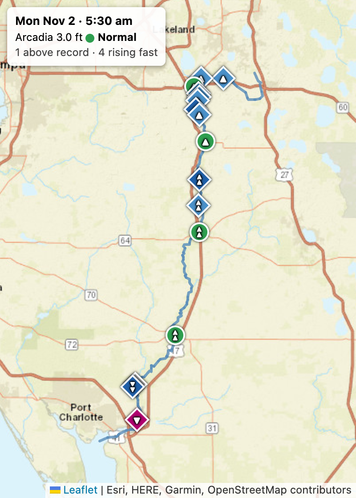
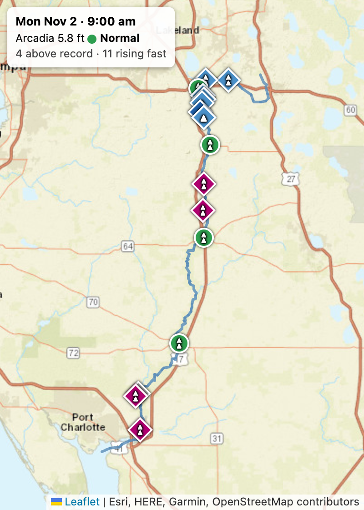
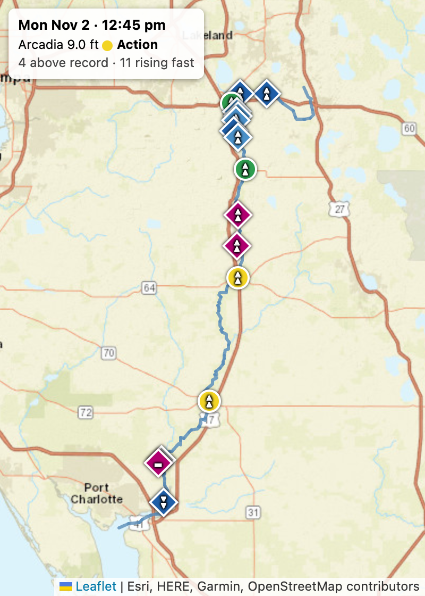
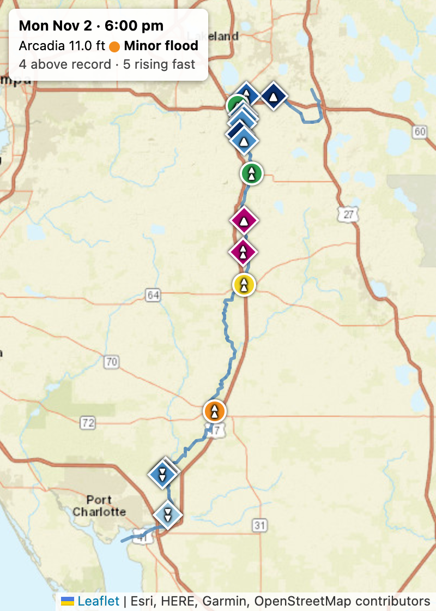
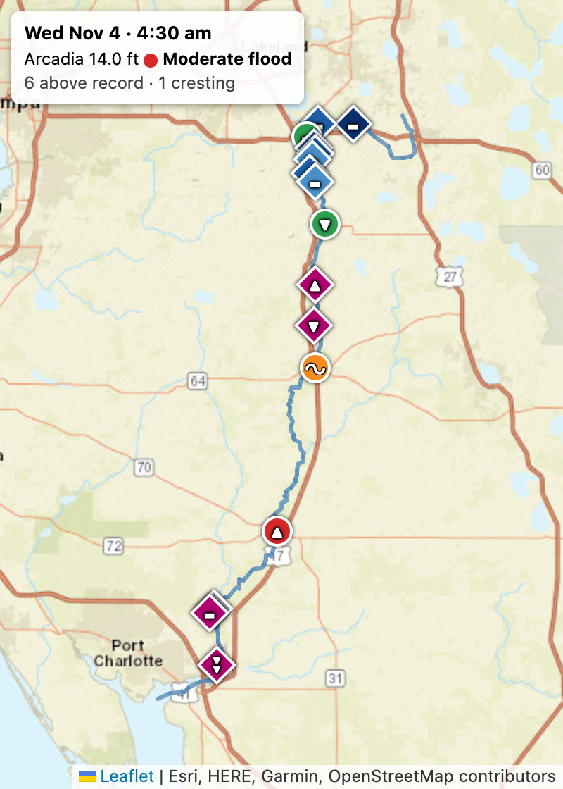
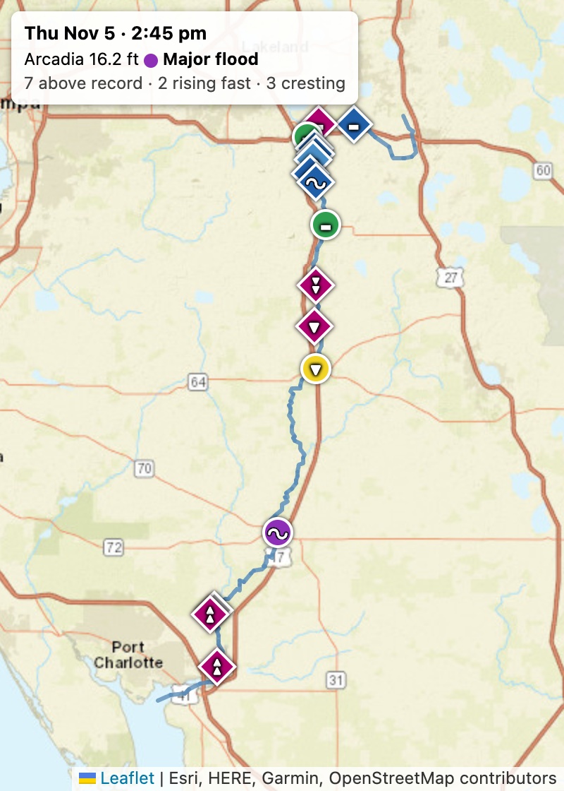

# Arcadia, November 2026: a storm in six frames

[Back to the README](../README.md)

The Peace River at Arcadia, Florida (USGS 02296750, NWS gauge ARCF1) climbed through every NWS flood
category between Monday, November 2 and Thursday, November 5, 2026. This page follows that climb in six
frames. Each frame is a real map made after the fact with the tool's
[`--as-of` option](../README.md#the-river-at-a-past-moment): the whole river as it was at that moment,
with the same colors, glyphs and legend as a map made today.

> **Not for safety decisions.** These are USGS provisional readings, drawn by a personal
> data-visualization tool. For flood warnings use the official NWS pages at
> [water.noaa.gov](https://water.noaa.gov).

Each frame is captioned with its moment, Arcadia's stage and category, and two counts across the river:
gages above the record for the date, and gages rising fast. Colors, diamonds and glyphs are explained in the
README's [legend sections](../README.md#diamond-colors-three-modes); in short, circles are colored by NWS
flood category, magenta diamonds are above the record for the date, and a wave marks a gage that is cresting.

## The climb starts

The river was climbing fast well before it reached action stage. Between 2:30 and 9:00 am on Monday,
November 2, Arcadia rose 3.6 ft, from 2.22 ft to 5.85 ft, and was still 3 ft short of the 9 ft action stage.

| Moment | Arcadia | What the map shows |
|---|---|---|
| Mon Nov 2, 2:30 am | 2.22 ft, +0.005 ft/h | Flat, as it had been all of Sunday. The starting point; no frame. |
| Mon Nov 2, 5:30 am | 3.02 ft, +0.11 ft/h | The first reading over the "rising fast" line of 0.10 ft/h. 4 gages are rising fast. |
| Mon Nov 2, 9:00 am | 5.85 ft, +0.58 ft/h | 11 of 16 gages are rising fast and 4 are above the record. Still no gage at action stage. |

## Climbing through the stages

Arcadia's first reading at or above each NWS stage, from the USGS readings available as of Thursday,
November 5, 2026, 3:51 pm EST:

| NWS category | Stage | First reading at or above it |
|---|---|---|
| Action | 9 ft | Mon Nov 2, 12:45 pm (9.01 ft) |
| Minor flood | 11 ft | Mon Nov 2, 6:00 pm (11.00 ft) |
| Moderate flood | 14 ft | Wed Nov 4, 4:30 am (14.00 ft) |
| Major flood | 16 ft | Thu Nov 5, 3:45 am (16.00 ft) |

The first touch of major flood was a single reading: exactly 16.00 ft at 3:45 am, then five readings just
under 16 ft. The river has been at or above 16 ft since 6:00 am. As of 3:51 pm EST the latest reading
(3:30 pm) was 16.25 ft, tied with the highest so far (1:45 pm).

## Frame by frame

### Mon Nov 2, 5:30 am: the river starts to rise

<table><tr>
<td width="300"></td>
<td valign="top">

Arcadia is at 3.0 ft, well under the 9 ft action stage, and only just starting to move: +0.11 ft/h, the
first reading that crosses the tool's "rising fast" line of 0.10 ft/h. Four gages are rising fast. Several
upstream diamonds already show double arrows, and Zolfo Springs is climbing at +0.31 ft/h.

No gage is in flood yet. Arcadia was flat at about 2.2 ft all day on Sunday, then began climbing in the small hours
of Monday.

</td>
</tr></table>

### Mon Nov 2, 9:00 am: the whole river is rising

<table><tr>
<td width="300"></td>
<td valign="top">

Three and a half hours later Arcadia is at 5.8 ft, still "normal" but climbing at +0.58 ft/h, almost six
times the rising-fast line. Eleven of the 16 gages are now rising fast, and 4 are above the record for
the date.

Still no gage is in flood, and none has reached its action stage. Every gage on the map that is moving
shows a double arrow.

</td>
</tr></table>

### Mon Nov 2, 12:45 pm: action

<table><tr>
<td width="300"></td>
<td valign="top">

Arcadia is at 9.0 ft, the NWS action stage, and rising nearly a foot an hour (+0.98 ft/h).

Of the 16 gages, 11 are rising faster than 0.10 ft/h,
so the map is full of double arrows, and 4 are already above the record for the date. Nothing is past
action stage yet. The map shows a basin-wide rise before any gage has reached flood stage.

</td>
</tr></table>

### Mon Nov 2, 6:00 pm: minor flood

<table><tr>
<td width="300"></td>
<td valign="top">

Five and a quarter hours later Arcadia reaches 11.0 ft, minor flood, still climbing at +0.38 ft/h.

The climb is slowing: 5 gages are rising fast now, down from 11. The fast part of the rise is easing, and 4 gages are above the record for the date.

</td>
</tr></table>

### Wed Nov 4, 4:30 am: moderate flood

<table><tr>
<td width="300"></td>
<td valign="top">

A day and a half later, Arcadia is at 14.0 ft, moderate flood, and has slowed to +0.096 ft/h.

The sharp surge upstream has passed: no gage is rising fast, and 6 are above the record. Zolfo Springs,
upstream and in minor flood at 16.6 ft, carries the wave, because its peak has just gone by. The flood is now a slow wave moving down the river.

</td>
</tr></table>

### Thu Nov 5, 2:45 pm: major flood, cresting

<table><tr>
<td width="300"></td>
<td valign="top">

Arcadia is at 16.2 ft, in major flood since 6:00 am, and levelling off at +0.018 ft/h. It is 0.04 ft
under its 7-day high of 16.25 ft from an hour earlier.

Zolfo Springs has fallen back to action stage while Arcadia, downstream, is at the top of its rise.
Seven gages are above the record for the date, and three are cresting: Arcadia, the Peace River near
Bartow, and the Peace River near Homeland. This is the image the wave glyph was made for.

</td>
</tr></table>

For the colors and glyphs, see the README on the
[percentile-for-this-date colors](../README.md#diamond-colors-three-modes) and the
[trend glyphs, including the wave](../README.md#the-trend-glyph).

## How these frames were made

```
python3 streamgage.py "Peace River" --state FL --as-of 2026-11-02T05:30-05:00
python3 streamgage.py "Peace River" --state FL --as-of 2026-11-02T09:00-05:00
python3 streamgage.py "Peace River" --state FL --as-of 2026-11-02T12:45-05:00
python3 streamgage.py "Peace River" --state FL --as-of 2026-11-02T18:00-05:00
python3 streamgage.py "Peace River" --state FL --as-of 2026-11-04T04:30-05:00
python3 streamgage.py "Peace River" --state FL --as-of 2026-11-05T14:45-05:00
```

Each run writes a page named for its moment, such as `peace_river_2026-11-02_1245_gages.html`. I switched
each page to "Percentile for this date" and photographed it in headless Chrome, zoomed to the river, with
a caption added to each photo. The captions are not made by the tool.

The 5:30 am time is the first 15-minute reading at which Arcadia's 6-hour trend passes 0.10 ft/h, the
tool's "rising fast" threshold. The 9:00 am time is the first hour on the hour when 11 gages were rising fast (7 at 8:00 am). The next three times are the
first readings at or above each NWS stage, from Arcadia's own readings
(the table above). The last was found by scanning every 15 minutes since major flood began for the
moment with the most gages meeting the cresting rule. It was 2:45 pm, with three. That scan was a
one-off script, not part of the tool.

## Things to know

- **No forecasts.** The NWS keeps no past forecasts, so these frames have no forecast rings. For
  reference, the forecast the NWS had issued that morning (10:24 am EST on November 5) put the crest at
  16.4 ft that evening, about two tenths of a foot above where the river was at 2:45 pm.
- **The data and the stages.** The readings are USGS provisional data, which the USGS may revise. The
  flood stages are today's, from NWS gauge ARCF1.
- **The last frame is an illustration, not a steady state.** Gages sitting at their weekly high can
  move in and out of "cresting" from one 15-minute reading to the next as sensor noise of about a
  hundredth of a foot shifts which reading is the maximum. Three cresting gages at 2:45 pm was the
  best moment found, not the typical one.
- **"Above the record" depends on the length of the record.** Arcadia's record for this date covers 95
  years (1932 to 2026), and its previous high for November 5 (the highest daily mean) was 8.57 ft in 2006. Some other
  gages on the river have records as short as 10 years, so for them "above the record" is a weaker statement. See
  [Known limits](../README.md#known-limits) in the README.

Data: USGS National Water Information System (provisional) and NOAA National Weather Service flood
stages. Basemaps: Esri and the USGS National Map. Map library: Leaflet.
